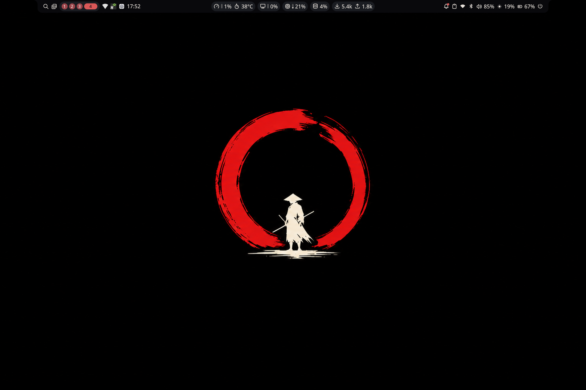
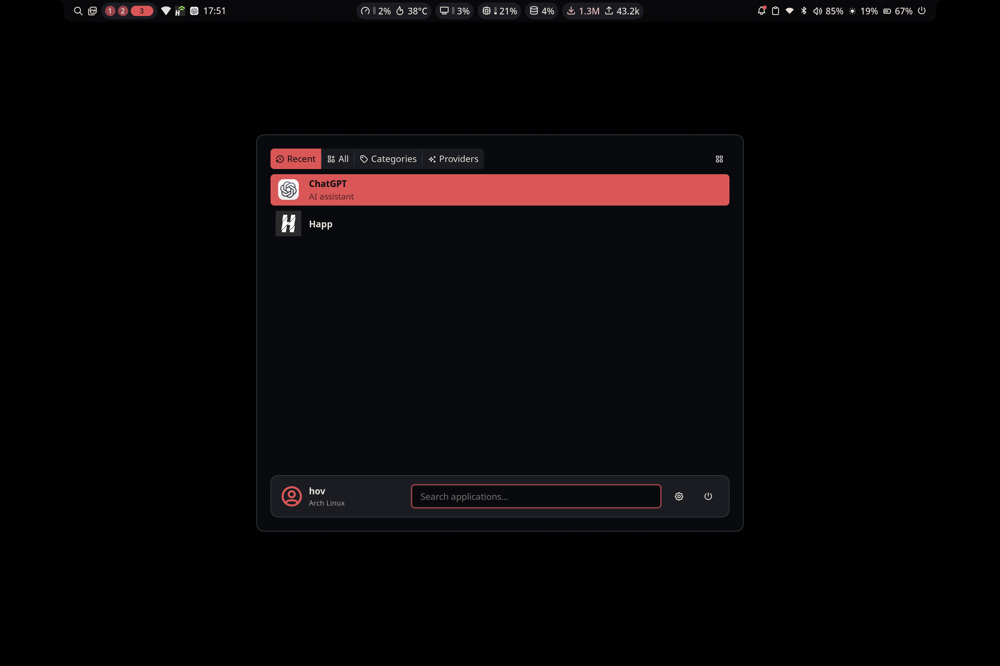
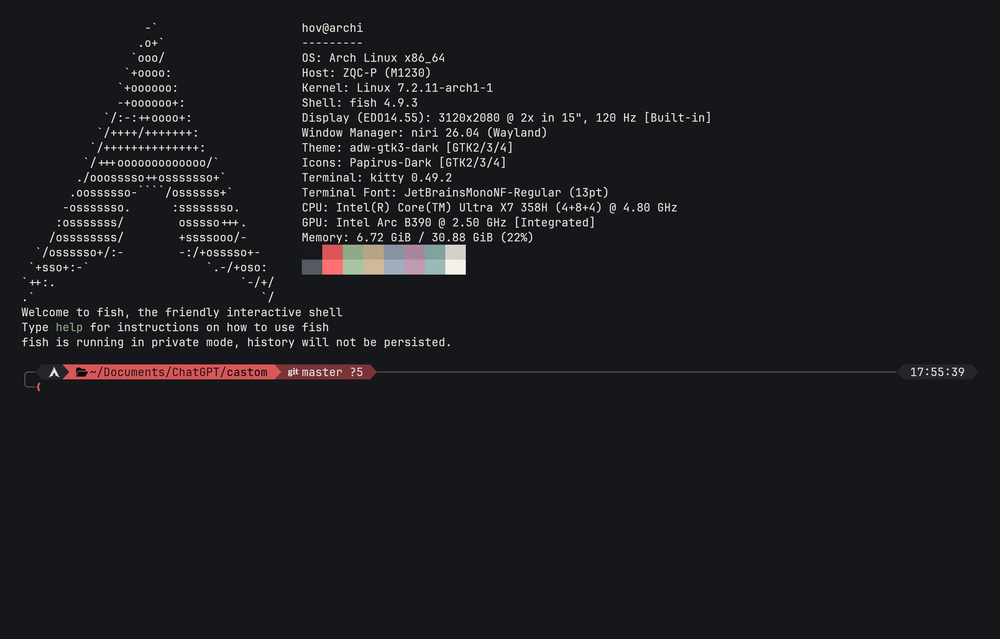
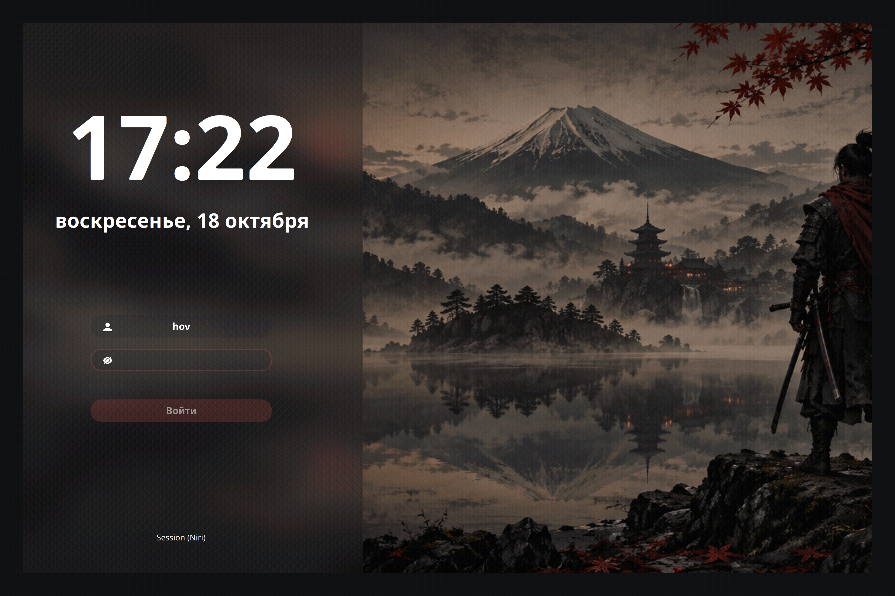
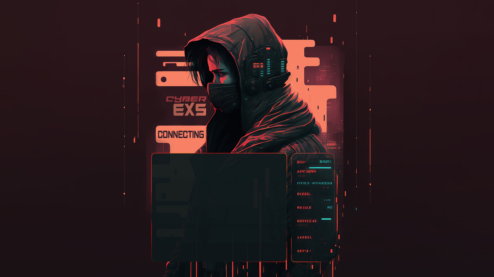

<div align="center">

# HONOR MagicBook Pro 14

### Arch Linux · Niri · Noctalia · Sumi Red

**ZQC-P / M1230 · Intel Core Ultra X7 358H · Intel Arc B390**  
3120 × 2080 · 120 Гц · 200% масштаб

[Внешний вид](#внешний-вид) · [Установка](#быстрое-восстановление) · [Состав](#состав) · [Клавиши](#клавиши) · [Восстановление](docs/RECOVERY.md)

</div>

> **Конфигурация именно для HONOR MagicBook Pro 14 (ZQC-P / M1230).**  
> Визуальная основа перенесена из конфигов Lenovo Legion, аппаратные настройки
> адаптированы под Intel и экран Honor. Вентиляторы Lenovo, NVIDIA/AMD-привязки
> и локальные модели Ollama в эту сборку не входят.



Тёмный рабочий стол с красными акцентами, плавающей панелью Noctalia,
единым оформлением приложений и модульными настройками Niri.
Это отдельная папка для Honor, без Git-истории и remote репозитория Lenovo.
Снимок конфигурации и скриншотов: **18 октября 2026 года**.

## Внешний вид

### Рабочий стол и меню приложений

На первом снимке — текущие обои с красным энсо, панель и рабочие столы Niri.
`Super+D` открывает меню Noctalia. Набор приложений в нём зависит от того,
что установлено и запускалось у пользователя.



<details>
<summary><b>Терминал Kitty, Fish/Tide и информация об оборудовании</b></summary>

Реальный снимок терминала на Honor. Палитра Sumi Red и JetBrainsMono Nerd Font;
на снимке также видны модель платы, процессор, графика и параметры дисплея.



</details>

### Экран входа SDDM

Графитовая форма, красные акценты, русская дата и масштаб 200%.
Ниже — **реальный скриншот режима предпросмотра SDDM**, запущенного на ноутбуке.
Это предпросмотр оформления, а не фиксация успешной авторизации.



### Загрузчик GRUB — CyberEXS

Тема включена в `grub/CyberEXS/` вместе с иконками и шрифтами.
На изображении ниже **исходный фон темы**, а не скриншот загрузочного меню.
Меню содержит Arch Linux, Windows Boot Manager (если найден на смонтированном EFI-разделе)
и настройки UEFI. Автоматические пункты EFI BootNext (USB, DVD, сеть и повторный GRUB)
отключены; сами записи UEFI сохранены. Дополнительные установленные ядра остаются доступны.
Windows определяется скриптом `grub/29_honor_windows` без привязки к UUID этого ноутбука.
Конфиг проверяется через `grub-script-check`; загрузку проверяйте после перезагрузки.



---

## Быстрое восстановление

Нужна уже установленная Arch Linux с доступом в интернет и обычным пользователем
с sudo. Скрипты не размечают диск и не устанавливают ОС или GRUB в EFI.

```bash
cd /путь/к/Honor-MagicBook-Pro-14
./restore.sh --dry-run  # проверка конфигов без изменений
./install.sh           # пакеты → конфиги → системные темы и службы
```

Выполняйте `install.sh` **без sudo**: отдельные системные операции сами его
запросят. Для AUR используется установленный paru/yay; если их нет, предлагается
проверить PKGBUILD и собрать yay. Существующая графическая сессия не прерывается.
После установки темы GRUB и SDDM применятся при следующей загрузке.

Установка частями:

```bash
./install-packages.sh
./restore.sh
sudo ./install-system.sh
./verify.sh
```

Для **другого имени пользователя** менять файлы вручную не нужно. Скрипт
подставляет домашнюю папку текущего пользователя вместо `@@HOME@@`, учитывает
`XDG_CONFIG_HOME`, `XDG_DATA_HOME`, `XDG_STATE_HOME` и `CODEX_HOME`.
Не копируйте файлы с `@@HOME@@` напрямую в ~/.config — используйте restore.sh.

## Состав

| Каталог / файл | Содержимое |
| --- | --- |
| `niri/` | Модульный конфиг, Intel GPU, экран Honor, US/RU phonetic, клавиши |
| `noctalia/`, `noctalia-state/` | Настройки оболочки, палитра и текущие изменения из интерфейса Noctalia |
| `kitty/`, `fish/`, `yazi/` | Терминал, Fish/Tide/Fisher, файловый менеджер |
| `zed/config/`, `zed/codebook/` | Оформление, клавиши, веб-инструменты, словарь |
| `gtk-3.0/`, `gtk-4.0/`, `qt5ct/`, `qt6ct/` | Оформление GTK и Qt |
| `btop/`, `helix/`, `micro/`, `telegram-desktop/` | Темы приложений |
| `codex/themes/`, `color-schemes/` | Дополнительные цветовые схемы |
| `wallpapers/` | Обои из прежней сборки |
| `brave-flags.conf` | Brave через Wayland, Vulkan отключён для совместимости |
| `grub/CyberEXS/` | Полная тема GRUB с фоном, иконками и шрифтами |
| `sddm/` | Экран входа Sumi Red и конфиг масштаба 200% |
| `hardware/` | Действующий патч тачпада, mkinitcpio hook, паспорт совместимости |
| `packages/` | Установочные списки и справочный снимок установленных пакетов |
| `scripts/` | Переносимое восстановление с проверкой и резервными копиями |
| `docs/` | Оборудование, программы, восстановление и откат |
| `screenshots/`, `attachments/` | Реальные скриншоты системы, предпросмотр входа и графические ресурсы |

Brave — браузер по умолчанию для HTTP/HTTPS/HTML и на `Super+B`.
Noctalia v5 устанавливается из официального репозитория Arch.
Zed использует VSCode Dark Modern и Material Icon Theme. Локальный ИИ отключён:
моделей Ollama, ИИ-коммитов и локального переводчика в этом наборе нет.

## Патч тачпада — отдельно

При обычной установке существующий ACPI override сохраняется, но готовая
аппаратная таблица автоматически не устанавливается на новую систему.
Для **того же HONOR ZQC-P / M1230 с BIOS 1.10**:

```bash
sudo ./install-system.sh --acpi
```

Скрипт проверяет DMI, BIOS и контрольную сумму таблицы, добавляет `acpi_override`
в HOOKS и пересобирает initramfs. На другом BIOS или модели он откажется от
установки. Обновление BIOS требует повторного анализа исходной ACPI-таблицы.
Подробности — [docs/HARDWARE.md](docs/HARDWARE.md).

## Клавиши

Навигация стрелками также доступна через **H/J/K/L** с теми же модификаторами.
Сохранён порядок исходного конфига: **H ←, J ↑, K ↓, L →**.

| Сочетание | Действие |
| --- | --- |
| Super+H/J/K/L | Фокус в соответствующем направлении |
| Super+Shift+H/J/K/L | Переместить колонку влево/вправо или окно вверх/вниз |
| Super+Ctrl+J/K | Предыдущий / следующий рабочий стол |
| Super+Ctrl+Shift+J/K | Перенести колонку на соседний рабочий стол |
| Super+Ctrl+H/L | Фокус на мониторе слева / справа |
| Super+Ctrl+Shift+H/L | Перенести колонку на монитор слева / справа |


| Клавиши | Действие |
| --- | --- |
| Super+Enter | Kitty с Fish |
| Super+D | Меню приложений Noctalia |
| Super+B | Brave |
| Super+E | Nautilus |
| Super+M | cliamp |
| Super+Space | US / русская фонетическая раскладка |
| Super+Alt+L | Блокировка Noctalia |
| Super+Shift+/ | Подсказка клавиш Niri |
| Fn / мультимедийные клавиши | Звук, микрофон, яркость, воспроизведение |

## Проверка и резервные копии

```bash
./verify.sh --repo    # проверяет экспорт без установки
./verify.sh           # проверяет действующую систему
sha256sum -c SHA256SUMS
```

`restore.sh` сохраняет заменяемые файлы и настройки GTK в
`~/.local/state/honor-magicbook-config-backups/<дата-время>` и печатает команду отката:

```bash
./restore.sh --rollback /путь/к/резервной-копии
```

`install-system.sh` сохраняет системные файлы в
`/var/backups/arch-honor-config-<дата-время>`. Путь последней копии записан в
`/var/backups/arch-honor-config-last`. См. [docs/RECOVERY.md](docs/RECOVERY.md).

В экспорт не включены пароли Wi-Fi, профили VPN, браузерные сессии, токены,
SSH-ключи, история терминала и состояние учётных записей приложений.
Снимок — набор настроек и ресурсов, а не образ диска.

## Проверено на ноутбуке

Wi-Fi подключается; динамики работают через PipeWire, пользователь подтвердил
нормальную громкость на 85%; цифровой микрофон отдаёт сигнал; камера передаёт
кадры; яркость меняется; Bluetooth включён; PPD работает в balanced.
Ошибочных systemd units на момент проверки не было.
Экран входа проверен в test-mode, GRUB — grub-script-check.
Сон/пробуждение, отпечаток пальца и Bluetooth-периферия не проверялись.


## Источники ресурсов

- CyberEXS 1.0.0 — архив, предоставленный владельцем ноутбука; ресурсы сохранены.
  В архиве не было отдельного файла лицензии, общая лицензия на них не назначается.
- SDDM Sumi Red — производная от [Keyitdev/sddm-astronaut-theme](https://github.com/Keyitdev/sddm-astronaut-theme).
  Исходные notices и GPL-3.0-or-later сохранены в `sddm/sumi-red/LICENSE`.
- Остальные темы, плагины Fish и конфиги происходят из старого репозитория и
  текущих настроек владельца; существующие notices сохранены.

## Пакеты: команда pac

По умолчанию используется **Shelly**. Менеджер можно выбрать для одной команды:

```fish
pac search firefox              # таблица до 25 пакетов, официальные репозитории + AUR
pac search --all firefox        # весь список
pac info firefox                # подробности отдельно
pac -shelly update
pac -pacman search firefox      # только официальные репозитории
pac -yay install brave-bin
pac -paru search browser        # если paru установлен
pac help
```

Флаги `-shelly`, `-pacman`, `-yay`, `-paru` ставятся перед командой.
При отсутствии выбранного менеджера выводится ошибка; автоматической подмены нет.
Локальная база пакетов, сироты, кэш и скачивание через Shelly обслуживаются pacman.
Поиск ничего не устанавливает. `--all` показывает все результаты, возвращённые менеджером;
Shelly ограничивает широкую выдачу AUR (об этом выводится подсказка). Ошибки сети обозначаются как неполный поиск.
После восстановления конфига откройте новый Fish или выполните
`source ~/.config/fish/config.fish` в текущем терминале.
Таблица поиска содержит имя, версию, источник, размер скачивания и сокращённое описание.
Размер относится к самому пакету без зависимостей; для AUR он заранее неизвестен (прочерк).
Описание сокращается по ширине терминала, полное доступно через `pac info <пакет>`.
Реализация: `fish/functions/pac.fish` и `fish/pac-search.py` (Python 3).

## Сканер отпечатка пальца

Для EgisTec `1c7a:05aa` подготовлена отдельная установка: `./install-fingerprint.sh`.
Используется дополнительный драйвер SDCP; стандартный libfprint сохраняется.
Регистрация пальца выполняется локально, отпечатки в GitHub не попадают.
Запись отпечатка, распознавание и разблокировка Noctalia через fprintd проверены на этом Honor.
Пароль остаётся доступен. Отпечаток для sudo включается отдельно: `sudo ./enable-sudo-fingerprint.sh`.
Вход SDDM остаётся парольным.
Подробности и ограничение при двойной загрузке Windows: [FINGERPRINT.md](docs/FINGERPRINT.md).

## Исправление ложной клавиши микрофона

У FocalTech `2808:5662` вспомогательный интерфейс `UNKNOWN` генерировал
бесконечный повтор KEY_MICMUTE. Включено точечное правило udev для этого
интерфейса и отключён повтор клавиш mute в Niri. Сенсорный экран и основная
клавиатура сохраняются. Подробности: [HARDWARE.md](docs/HARDWARE.md).
