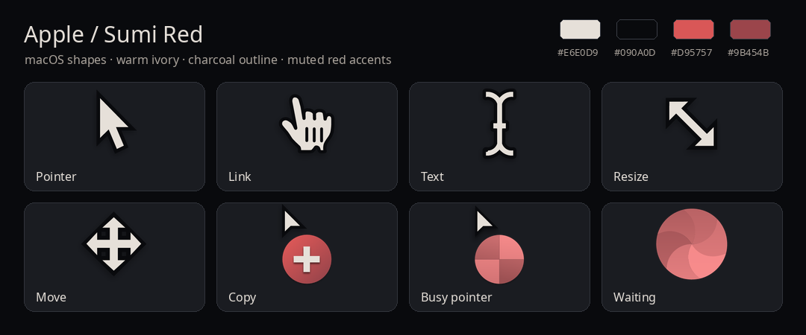

# Apple / Sumi Red

Курсоры Apple в палитре рабочего стола Honor: тёплый светлый `#E6E0D9`,
тёмная обводка `#090A0D`, красные акценты `#D95757` / `#9B454B`.
Цветные индикаторы ожидания перекрашены в красную гамму, анимации сохранены.
Включены 14 размеров от 16 до 96 px, в том числе 24 и 48 для масштаба 200%.



`Apple-Sumi-Red/` — готовая Xcursor-тема для Niri/Wayland и X11/XWayland.
`restore.sh` устанавливает её в `~/.local/share/icons/`, настраивает курсор Niri,
GTK, dconf и пользовательскую тему по умолчанию. Размер — 24 логических пикселя.
Некоторые уже открытые приложения обновляют курсор только после перезапуска.

## Исходники и сборка

Основа: [ful1e5/apple_cursor](https://github.com/ful1e5/apple_cursor),
commit `fe044a42b4e9cea16ea762d2ed9004f6d7b35543`, лицензия GPL-3.0.
Оригинальные SVG, manifest с hotspots/алиасами и лицензия включены в `source/`.
Изменения цвета выполняет `source/render.cjs`; сборку — `source/build.py`.

Сборка не требует sudo, но нужны Node.js/npm, Python и venv:

```bash
cd cursors/source
npm ci --no-audit --no-fund
python -m venv .venv
.venv/bin/pip install -r requirements.txt
PATH="$PWD/.venv/bin:$PATH" .venv/bin/python build.py
```

Для возврата Adwaita задайте `xcursor-theme "Adwaita"` в `niri/cfg/misc.kdl`,
`cursor-theme='Adwaita'` в `desktop-interface.ini` и соответствующие значения
в GTK settings.ini и `cursors/default/index.theme`, затем выполните restore.sh.
