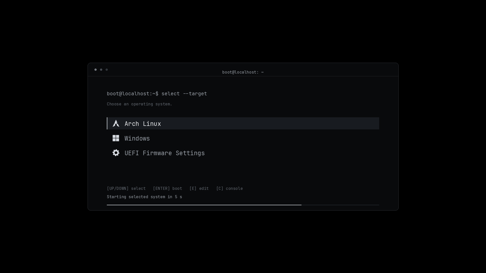

# Void Terminal

Тема стандартного GRUB gfxmenu: чёрный фон, терминальное окно по центру,
монохромное меню и иконки Arch, Windows и системных настроек рядом с пунктами.
Текущая тема рабочего стола, имя пользователя и модель ноутбука не используются.



`preview.png` — иллюстративный макет 1920×1080. Реальный GRUB рисует текст
растровыми PF2-шрифтами, поэтому сглаживание и точные метрики могут отличаться.
Пункты меню берутся из существующего `grub.cfg`: тема не переименовывает их
и не меняет ядра, Windows, UEFI-записи или порядок загрузки.

Живыми остаются выбор пункта, секундный отсчёт и полоса тайм-аута.
Иконки 32×32 выбираются штатным GRUB по `--class` записи меню:
`arch`/`archlinux`, `windows`, `firmware`/`efi`/`fwsetup` и другие.
Иконки нарисованы в `build.py` и включены в каталог `icons/`.
Для штатной записи UEFI без класса установщик добавляет `--class firmware`
в создаваемый grub.cfg. После ручной пересборки grub.cfg стандартным генератором
эта иконка может исчезнуть; повторный запуск установщика возвращает её.

## Установка

```sh
./install.sh
```

Установщик запрашивает sudo, сохраняет `/etc/default/grub` и `grub.cfg` в
`/var/backups/grub-void-terminal-<дата>/`, копирует тему в
`/boot/grub/themes/void-terminal/`, устанавливает видеорежим
`1920x1080,auto`, убирает дубли GRUB_THEME/GRUB_GFXMODE и пересобирает конфиг.
Новый конфиг проходит `grub-script-check` перед заменой действующего.
При ошибке конфигурация восстанавливается. Перезагрузка не запускается.

Для ручного отката скопируйте `default-grub` из нужной резервной копии в
`/etc/default/grub`, а `grub.cfg` — в `/boot/grub/grub.cfg` с правами root.
Не восстанавливайте старый grub.cfg после последующих обновлений ядер;
в этом случае восстановите только default-grub и выполните grub-mkconfig.

## Сборка и ограничения

Готовые PNG/PF2 уже включены. Для пересборки `build.py` нужны Python с Pillow,
`grub-mkfont` и пакет `ttf-jetbrains-mono-nerd`. Шрифт JetBrains Mono/Nerd Fonts
распространяется по OFL, лицензия приложена. Название семейства PF2 — Void Mono.

Разметка рассчитана на 1920×1080. При выборе fallback-видеорежима размеры
шрифта остаются пиксельными; на другом разрешении требуется визуальная проверка.
Макет проверен визуально, файлы шрифта созданы grub-mkfont. Запуск в GRUB/UEFI
ещё не проверен. grub-script-check проверяет скрипт загрузки, а не theme.txt.

Документация: https://www.gnu.org/software/grub/manual/grub/html_node/Theme-file-format.html
